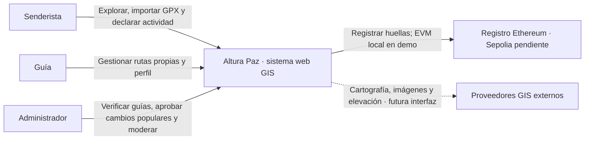
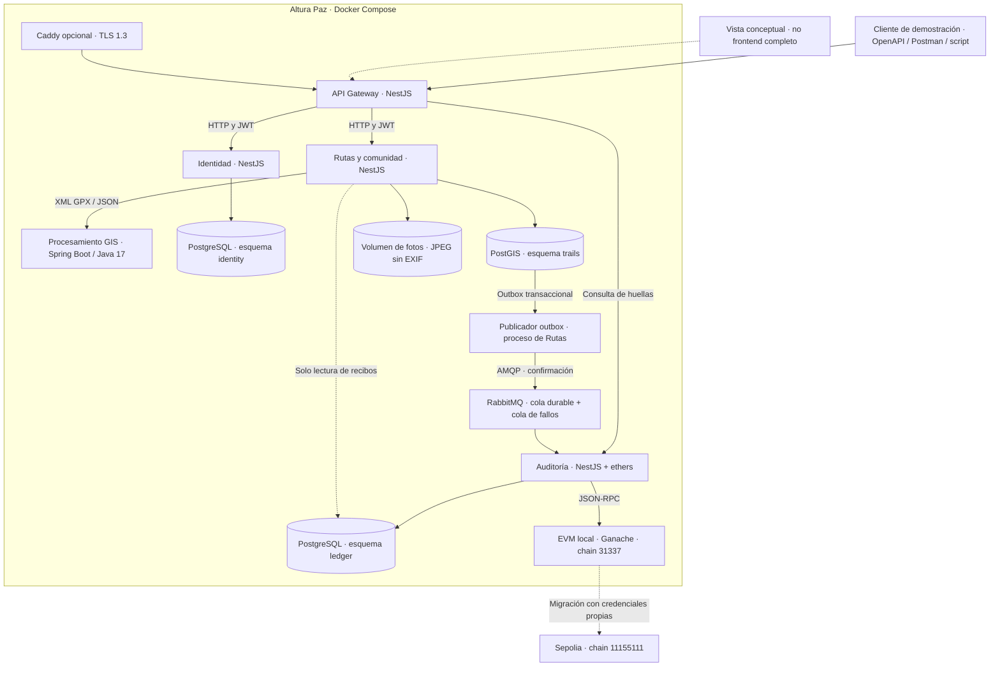
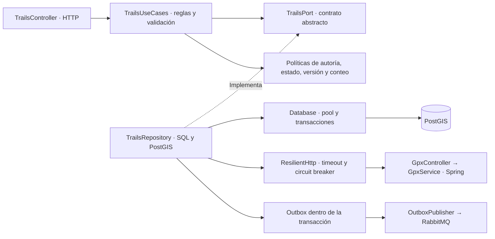
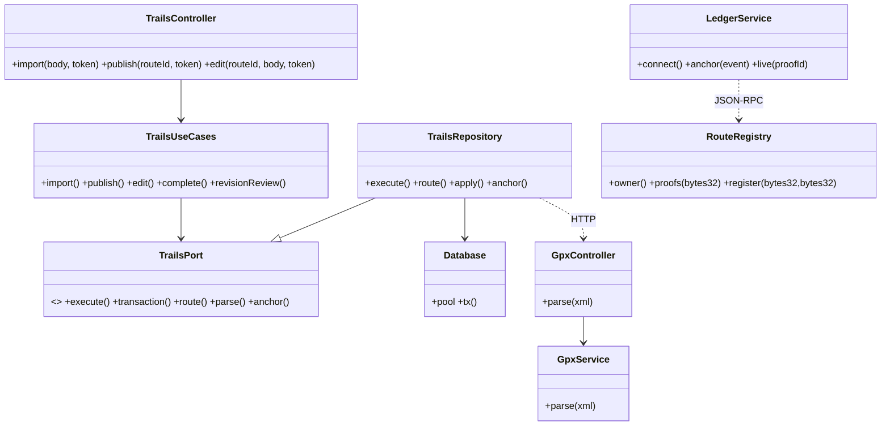
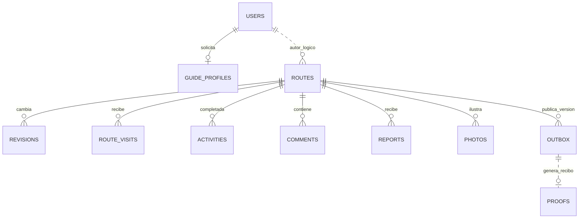

# Diagramas de arquitectura de Altura Paz

Los diagramas describen el prototipo local. Las integraciones externas GIS se investigaron y no forman parte del camino crítico de la demo. La vista de frontend es conceptual.

## C4 nivel 1: contexto

## C4 nivel 2: contenedores

Los tres esquemas comparten una instancia física de PostgreSQL con credenciales distintas. No hay alta disponibilidad ni aislamiento físico entre bases en este MVP. El catálogo tiene permiso de lectura sobre los recibos del ledger; una futura API o proyección de eventos eliminará ese acoplamiento. Docker DNS resuelve nombres de servicio y cumple el descubrimiento básico; no se instala Eureka.

## C4 nivel 3: componentes del catálogo

Los controllers delegan en casos de uso. Las sentencias SQL están en los adaptadores de persistencia. Se aplica inversión de dependencias mediante puertos abstractos. Los puertos de esta primera versión son pequeños y genéricos; conviene sustituir los comandos con nombre por métodos tipados de dominio al crecer el equipo.

## C4 nivel 4: clases y contrato

## Modelo de persistencia

Las líneas lógicas entre contextos no son claves foráneas entre esquemas. Dentro de cada contexto sí se utilizan claves y restricciones SQL. El DDL exacto está en `db/001-schema.sql`.
